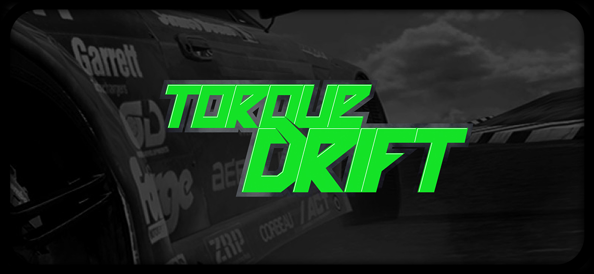
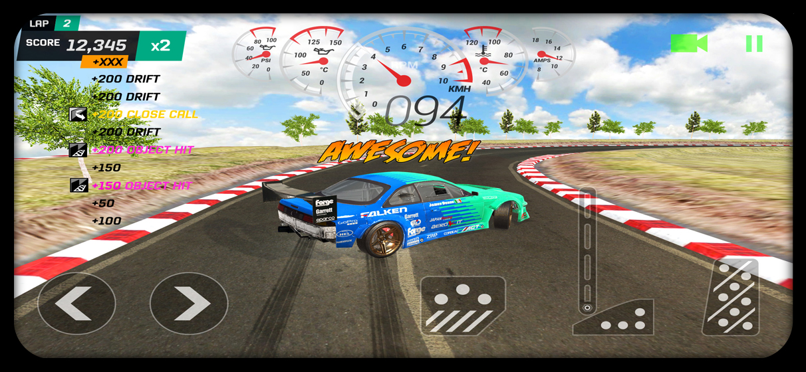
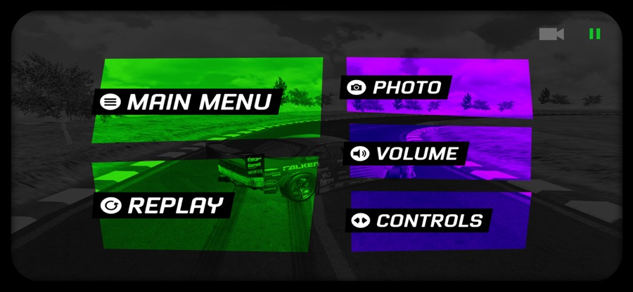
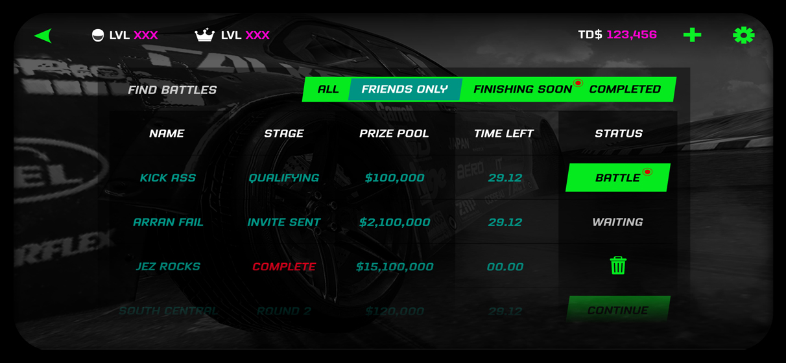
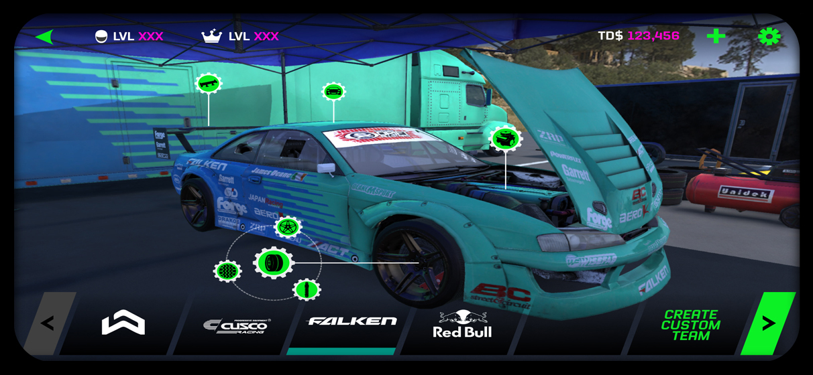
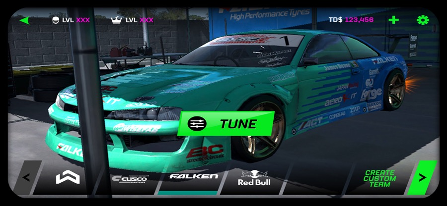
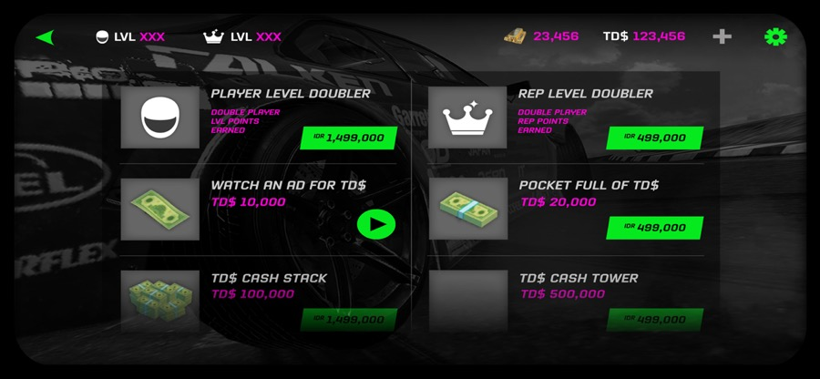
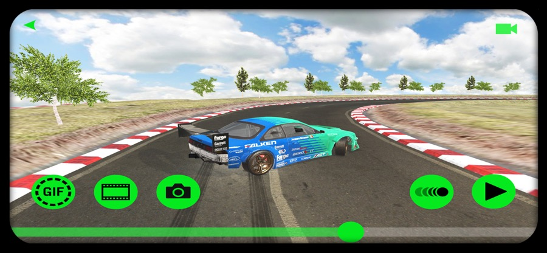
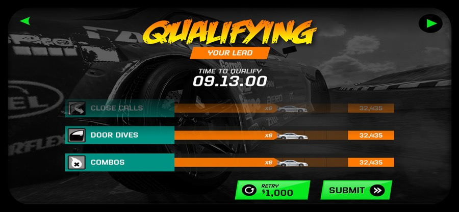
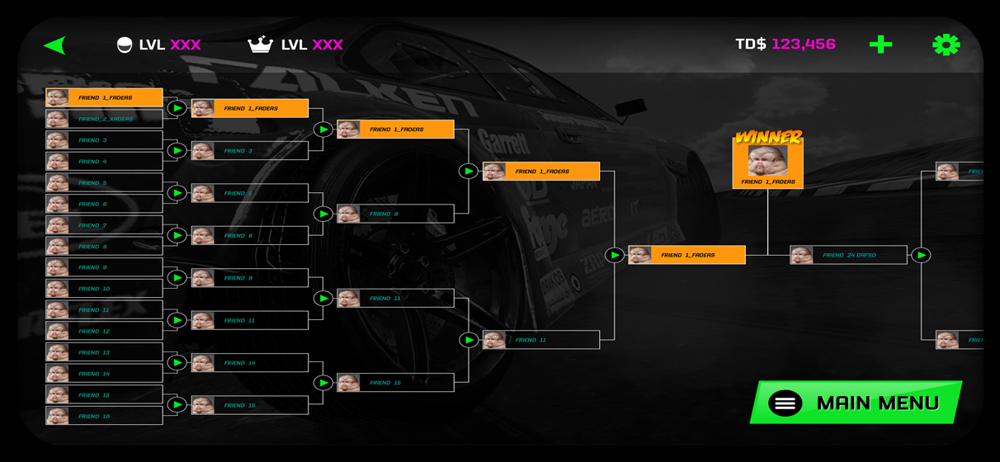

import DeviceFrame from '../../components/DeviceFrame.astro';
import ImageGrid from '../../components/ImageGrid.astro';
import FullBleedImage from '../../components/FullBleedImage.astro';
import SectionHeading from '../../components/SectionHeading.astro';
import infoArchitectureImg from '../../assets/case-studies/torque-drift/01.png';
import wireframesImg from '../../assets/case-studies/torque-drift/02.jpg';

<SectionHeading level="section">The project</SectionHeading>

An exciting opportunity presented itself when a business acquaintance reached out with a proposition — to join a new game project he’d been working on. He’d already launched a successful game, Torque Burnout, and wanted to make the next one with a new business partner: a car drifting game built around online head-to-head racing. He needed someone who could help with the game concept, game design, mechanics and user experience, and who could help run the business.

The game had some ambitious parts. Players could buy car upgrades and modifications from real-world brands in a virtual store, which meant building relationships and contracts with those companies. Some tracks were replicas of real-world tracks, and they needed agreements too. I was excited to be part of it, and I joined Boom Boss Games to make it happen.

<SectionHeading level="section">What we were aiming for</SectionHeading>

We wanted the driving to feel real: realistic car physics, convincing tyre smoke, authentic tracks and cars players could customise. But the menus around the driving had to stay simple. A player who just wanted to race shouldn’t have to dig through a garage to get there, and a player who loved tuning should find all of it in one place.

<SectionHeading level="section">My role</SectionHeading>

I had two roles. As Head of UX, I owned the design process end to end, from user research through information architecture, wireframes and prototypes to the final UI, and I worked closely with the developers to make sure the designs were built as intended and tested for usability.

Research started with the competition. I played and reviewed other racing and drifting games to see how they handled menus, upgrades and controls, and where they lost people. Once we had builds, I watched people play them and ran playtests, which showed us where players got stuck, what they skipped and which controls felt awkward in their hands.

As a business partner, I worked on the game concept and mechanics, and on the business side: partnerships, contracts with industry partners, funding, marketing and new revenue streams.

<SectionHeading level="section">Information architecture</SectionHeading>

Racing game menus can get deep quickly, so I started by mapping the whole structure before designing any screens. The main menu splits into three areas: **Drive**, where players race; the **Pit**, where they choose a team and tune their car; and the **Store**.

Drive has three modes: Practice on individual tracks, a Career that moves through regions of the world, and Battles against local or online opponents. Whichever way in, every mode ends at the same race and summary screens, so players only have one race screen to learn and we only had one to build and polish. In the Pit, players can change the car, engine, transmission, body, wheels and suspension, right down to camber, ride height and springs. The Store is organised around teams, each with a garage, body shop, wheel shop and car dealer.

<FullBleedImage src={infoArchitectureImg} alt="Torque Drift information architecture: the main menu splits into Drive (Practice, Career, Battles), Pit and Store, with every Drive mode leading to Race and Summary" />

<SectionHeading level="section">Wireframes</SectionHeading>

I mocked up the main flows on top of in-game renders rather than grey boxes, so we could judge each layout against the real cars and tracks it would sit over. Career starts on a world map, where players pick a region, then a track, then their car. In the Store, players move from a team’s page into parts such as engines, and an **Equipped** state shows what’s already fitted, so nobody buys the same part twice.

<FullBleedImage src={wireframesImg} alt="Torque Drift wireframes showing the Pit, Store, Practice and Career flows mocked up over in-game renders" />

<SectionHeading level="section">UI design</SectionHeading>

The final UI had to work in landscape, with a thumb on each side of the screen. Steering sits on the left and the pedal controls on the right, leaving the middle of the screen clear for the car. Gauges run across the top, and the left edge keeps a running tally of drift points, close calls and object hits, with a score multiplier alongside.

In the garage, team liveries from real sponsors such as Falken, Cusco and Red Bull sit in a carousel along the bottom of the screen, and a single **Tune** button sits on the car itself, keeping the most common action one tap away.

<ImageGrid cols={1}>
<DeviceFrame variant="mobile-landscape" fit>

</DeviceFrame>

<DeviceFrame variant="mobile-landscape" fit>
  
</DeviceFrame>

<DeviceFrame variant="mobile-landscape" fit>
  
</DeviceFrame>

<DeviceFrame variant="mobile-landscape" fit>
  
</DeviceFrame>

<DeviceFrame variant="mobile-landscape" fit>
  
</DeviceFrame>

<DeviceFrame variant="mobile-landscape" fit>
  
</DeviceFrame>

<DeviceFrame variant="mobile-landscape" fit>
  
</DeviceFrame>

<DeviceFrame variant="mobile-landscape" fit>
  
</DeviceFrame>

<DeviceFrame variant="mobile-landscape" fit>
  
</DeviceFrame>

<DeviceFrame variant="mobile-landscape" fit>

</DeviceFrame>
</ImageGrid>

<SectionHeading level="section">The business side</SectionHeading>

We planned several ways to make money, including in-game purchases, subscriptions and advertising, so we could reinvest in development and promotion. We also looked for partnerships that would bring in new audiences. We partnered with a contact of mine who works in racing and is very well connected, and they helped us land deals with real brands like Falken, Cusco and Red Bull. We also had existing contacts in F1 motorsport and drag racing that we were able to use, and a good relationship with the App Store, which helped the game get featured and gave us useful insight into analytics, user feedback, marketing and the review process.

Torque Drift launched on the App Store and is still being updated today, with real pro drift teams, branded parts and online tandem battles. On the Australian App Store it holds a 4.6 rating from over 8,000 ratings.

<SectionHeading level="chapter">Final thoughts</SectionHeading>

The biggest lesson from Torque Drift wasn’t about the game. We were good at talking about what we wanted to build, but we never properly agreed on how the company would be structured and run: who owned what, how money would be managed and how resources would be allocated.

Unfortunately the partnership didn’t work out, because we couldn’t agree on those things. The disagreements became more pronounced as we started putting our plans into action, and despite our best efforts to find a compromise, the partnership eventually ended. It was a difficult and frustrating experience, but it taught me to get that clarity from the very beginning of any business partnership, before the exciting part starts.
